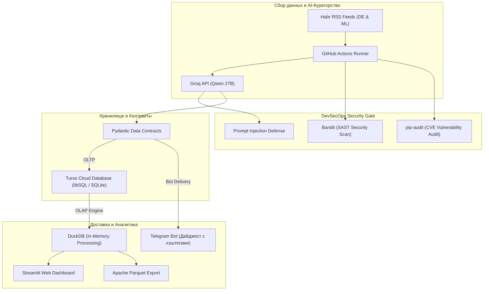

# 🧠 Habr Data & ML Intelligence Platform (with DevSecOps)

[](https://www.python.org/downloads/)
[](https://github.com/PyCQA/bandit)
[](LICENSE)

Автоматизированная платформа и serverless ELT-пайплайн для мониторинга, семантического анализа и агрегации технических публикаций с Хабра по направлениям **Data Engineering** и **Machine Learning**.

Проект разработан с соблюдением принципов разделения вычислений и хранилища (**Separation of Compute and Storage**) и встроенным контуром безопасности (**DevSecOps**) с нулевой стоимостью инфраструктуры ($0 Cloud Architecture).

---

## 🏗 Архитектура системы



---

## 🛡 Контур безопасности (DevSecOps)

В проекте реализован 4-уровневый контур безопасности без использования платных инструментов:
1. **AppSec:**
   * **Prompt Injection Defense:** фильтрация мета-команд в текстах статей.
   * **SQL Injection Prevention:** 100% параметризованные SQL-запросы в Turso и DuckDB.
   * **XSS / HTML Sanitization:** экранирование спецсимволов перед отправкой в Telegram API.
2. **SAST (Static Application Security Testing):**
   * Анализ исходного кода через **Bandit** на уязвимости, небезопасные вызовы и утечки.
3. **SCA (Software Composition Analysis):**
   * Аудит зависимостей через **pip-audit** по мировой базе уязвимостей CVE.
4. **Least Privilege (Принцип наименьших привилегий):**
   * Виртуальные машины GitHub Actions работают с правами `contents: read` без доступа к изменению репозитория.

---

## 🛠 Технологический стек

* **Оркестрация:** GitHub Actions (расписание: 09:00, 13:00, 18:00, 22:00 МСК).
* **AI & NER:** **Groq Cloud API** (`qwen/qwen3.8-27b`) — фильтрация шума, извлечение стека технологий и уровня сложности.
* **Качество данных (Data Quality):** **Pydantic v2** — валидация контрактов данных.
* **Облачное хранилище (DWH):** **Turso** (Serverless libSQL) в защищённом регионе Стокгольм.
* **Аналитический движок (OLAP):** **DuckDB** — векторные вычисления и агрегация тегов через функцию `unnest()`.
* **Визуализация (BI):** **Streamlit** — реактивный веб-дашборд с фильтрами по стеку.
* **Формат данных:** **Apache Parquet** (`pyarrow`) — генерация аналитического файла на лету.

---

## 🚀 Быстрый старт

1. Клонируйте репозиторий:
   ```bash
   git clone https://github.com/your-username/habr-bot.git
   cd habr-bot
   ```

2. Установите зависимости:
   ```bash
   pip install -r requirements.txt
   ```

3. Запуск пайплайна:
   ```bash
   python main.py
   ```

4. Запуск аналитического дашборда:
   ```bash
   streamlit run dashboard.py
   ```
