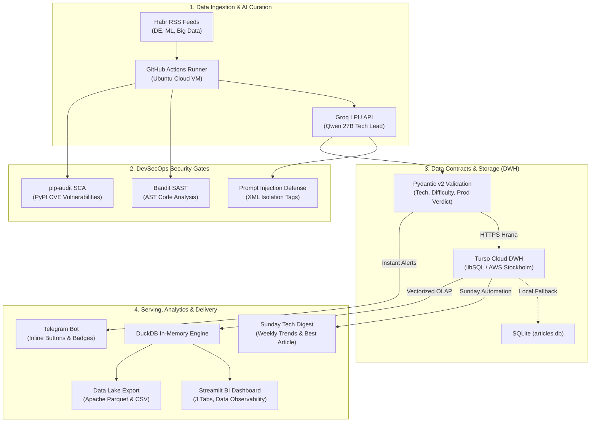

# Habr Data & ML Engineering Radar

[](https://www.python.org/downloads/)
[](https://github.com/PyCQA/bandit)
[](https://github.com/pypa/pip-audit)
[](https://turso.tech/)
[](https://duckdb.org/)
[](LICENSE)

ELT-пайплайн на GitHub Actions для мониторинга технических публикаций с Хабра по направлениям **Data Engineering**, **Machine Learning** и **Big Data**: фильтрация и структурирование статей через LLM, хранение в Turso, рассылка в Telegram и аналитический дашборд на Streamlit.

---

## Архитектура системы (End-to-End Pipeline)



---

## Ключевые возможности платформы

### 1. AI-фильтрация и ранжирование (Groq LPU)
* **Анти-кликбейт и фильтрация «воды»:** нейросеть `qwen/qwen3.8-27b` отбирает **максимум по 1 лучшей практической публикации** из каждого хаба за один запуск.
* **Строгий контракт данных (Data Contract):** извлечение метаданных валидируется через **Pydantic v2**:
  * Оценка грейда сложности: `Junior`, `Middle`, `Senior`, `Lead`.
  * Тип публикации: `Архитектура`, `Кейс`, `Гайд`, `Обзор`, `Анализ`.
  * Примерное время чтения (`read_time`): например, `~6 мин`.
  * Индекс применимости к продакшену (`prod_verdict`): `Готово к проду`, `Эксперимент`, `Только пет-проект`.
  * Список извлечённых сущностей стека (`tech_stack`).

### 2. Telegram Delivery с Inline-кнопками и аналитическим дайджестом
* **Интерактивные кнопки (Inline Keyboards):** быстрое открытие оригиналов статей прямо под постом в один клик.
* **Мульти-рассылка:** поддержка списка получателей через запятую (`TELEGRAM_CHAT_ID`).
* **Воскресный аналитический дайджест (Sunday Digest):** каждое воскресенье бот автоматически выгружает срез за неделю и рассылает:
  * Топ-3 технологии недели по данным DWH.
  * Архитектурную статью недели с ключевым инсайтом.
  * Идемпотентность гарантируется отдельной таблицей `digests` в базе данных.

### 3. Аналитический веб-дашборд (Streamlit + DuckDB)
* **In-Memory OLAP:** агрегации по статьям и тегам рассчитываются за доли миллисекунд движком **DuckDB** с использованием функции `unnest()`.
* **Data Observability & Качество данных (Data Quality):**
  * **Data Freshness (SLA):** таймер свежести данных с момента последней записи в DWH.
  * **Tech Stack Completeness:** процент полноты разметки технологий.
  * **Contract Completeness:** процент валидации выжимок.
  * **Primary Key Integrity:** 100% уникальность ссылок без дубликатов.
* **Data Lake Export:** генерация сжатого бинарного файла **Apache Parquet** (`pyarrow`) и CSV на лету.

---

## Контур безопасности (DevSecOps)

В проекте реализованы следующие меры безопасности:

1. **Защита от Prompt Injection (OWASP LLM Top 10):**
   * Весь входящий контент статей изолирован в XML-теги `<article_content>` с явной системной директивой игнорирования любых внутренних мета-инструкций.
2. **SAST (Static Application Security Testing):**
   * Анализ исходного кода на каждом CI/CD прогоне через **Bandit** (`-ll -ii`): 0 уязвимостей на 900+ строк кода.
3. **SCA (Software Composition Analysis):**
   * Автоматический аудит проектных зависимостей по базе CVE через **pip-audit**.
4. **AppSec & Network Hardening:**
   * Белый список официальных доменов (`https://habr.com/`) для защиты от SSRF.
   * Экранирование спецсимволов (`html.escape`) перед отправкой в Telegram API.
   * Глобальные таймауты сокетов (`socket.setdefaulttimeout(15)`) против зависания раннеров.
   * Безопасное освобождение соединений БД в блоках `try...finally: client.close()`.
5. **Least Privilege (Наименьшие привилегии):**
   * Раннеры GitHub Actions работают со строгими правами `contents: read`. Секреты хранятся в зашифрованных GitHub Secrets.

---

## Локальный запуск

1. **Клонируйте репозиторий:**
   ```bash
   git clone https://github.com/K0ldan/habr-bot.git
   cd habr-bot
   ```

2. **Установите зависимости:**
   ```bash
   pip install -r requirements.txt
   ```

3. **Настройте переменные окружения:**
   Скопируйте шаблон `.env.example` в `.env` и заполните свои ключи:
   ```bash
   cp .env.example .env
   ```

4. **Запуск ELT-пайплайна:**
   ```bash
   python main.py
   ```

5. **Запуск аналитического дашборда:**
   ```bash
   streamlit run dashboard.py
   ```

---

## Лицензия
Проект распространяется под открытой лицензией [MIT](LICENSE).
Автор: [@K0ldan](https://github.com/K0ldan)
